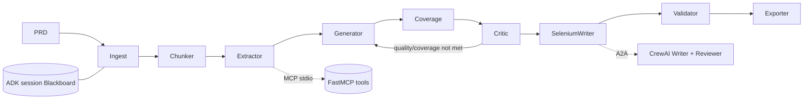

# PRD to Selenium multi-agent system

This project converts PDF, DOCX, Markdown, or text PRDs into typed test cases
and runnable pytest Selenium scripts.

## Architecture



The supported runtime is the deterministic, session-backed blackboard pipeline.
Set `ARCH=message_passing` to use the typed in-memory event-bus backend instead;
both backends expose the same validated state interface.
The optional ADK builder and A2A/CrewAI service remain available as integration
components, but are not selected implicitly. Unsupported architecture values
fail configuration validation instead of silently running the blackboard path.

## Setup and run

```powershell
py -3.11 -m venv .venv
.venv\Scripts\Activate.ps1
pip install -r requirements.txt
Copy-Item .env.example .env
python -m prd_agents --out output
```

## HTTP API

The separate FastAPI application exposes PRD uploads and sequential pipeline
runs without changing the existing CLI:

```powershell
uvicorn api.main:app --host 0.0.0.0 --port 8000
```

It provides `GET /health`, `GET /api/samples`, `POST /api/upload-prd`,
`POST /api/run`, `GET /api/runs`, `GET /api/runs/{run_id}`,
`GET /api/runs/{run_id}/results`, and `GET /api/runs/{run_id}/events`.
Model settings can be read with `GET /api/models/config`, updated with
`PUT /api/models/config`, and checked with `POST /api/models/test` using a
body such as `{"role":"critic"}`. Configure all four roles independently:

```json
{
  "roles": {
    "extractor": {
      "provider": "gemini",
      "model": "gemini-2.5-flash",
      "credential_ref": "GEMINI_API_KEY"
    },
    "generator": {
      "provider": "gemini",
      "model": "gemini-2.0-flash",
      "credential_ref": "GEMINI_API_KEY2"
    },
    "critic": {
      "provider": "groq",
      "model": "llama-3.3-70b-versatile",
      "credential_ref": "GROQ1"
    },
    "selenium": {
      "provider": "groq",
      "model": "llama-3.1-8b-instant",
      "credential_ref": "GROQ2"
    }
  }
}
```

`credential_ref` is an environment-variable name, never a key value. The
response includes only whether it is configured and a masked reference.
Settings stored in the API SQLite database contain provider/model choices and
credential references only; credentials are resolved from server environment
variables at runtime. The credential resolver is isolated so a future
deployment can replace it with an encrypted, user-scoped credential store.
Upload a `.md`, `.txt`, `.pdf`, or `.docx` PRD as multipart field `file`.
Start a run with either `{"upload_id":"..."}` or `{"sample_id":"sample_prd"}`;
the endpoint returns a run ID and the API processes it in a background task.
Poll the run endpoint until its status is `completed` or `failed`, then fetch
results and monitoring events. `POST /api/providers/validate` accepts a JSON
body such as `{"role":"generator"}` and checks the configured provider using
server-side credentials without returning the key.

## Web frontend

The TCgen Next.js dashboard lives separately in `frontend/` and connects to
the FastAPI endpoints for PRD samples, run submission, run history, live
monitoring, and model settings. Start it with:

```powershell
cd frontend
npm install
Copy-Item .env.example .env.local
npm run dev
```

Set `NEXT_PUBLIC_API_BASE_URL` in `frontend/.env.local` if the API is not at
`http://localhost:8000`. Set `CORS_ORIGINS` on the API server to include the
frontend origin. Configure provider credentials through server-side
environment-variable references in Model Configuration; never put provider
keys in `NEXT_PUBLIC_*` variables.

The API forces the existing `run_pipeline()` into the `blackboard` architecture
and `sequential` orchestration pattern. Set `CORS_ORIGINS` to a comma-separated
list of allowed frontend origins, and set `API_DATA_DIR` to the data directory.
The default run registry is SQLite and artifacts/uploads are stored on disk.
For deployment, mount persistent storage at `API_DATA_DIR`; this initial
background-task implementation is for a single persistent API instance, not a
serverless or multi-replica job queue. Long-running model calls should run on a
container service; a production multi-instance deployment should replace the
in-process task runner and local SQLite/files with a durable queue, managed
database, and object storage.

## LLM provider configuration

Each role (`EXTRACTOR`, `GENERATOR`, `CRITIC`, and `SELENIUM`) can select
`ollama`, `gemini`, or `groq` independently with its `*_PROVIDER` and
`*_MODEL` environment variables. Provider prefixes in the model name are
accepted too (for example `gemini/gemini-2.5-flash` or
`groq/llama-3.3-70b-versatile`). Set role-specific `*_API_KEY` values to keep
Generator and Critic credentials separate, or set `*_API_KEY_REF` to the name
of an environment variable that contains the key (for example,
`GENERATOR_API_KEY_REF=GEMINI_API_KEY2`). `GEMINI_API_KEY` and `GROQ_API_KEY`
are supported as server-side shared defaults; never put API keys in frontend
variables or return them from endpoints. The checked-in `.env.example` contains
empty credential placeholders only.

`MODEL_TIMEOUT_SECONDS`, `MODEL_MAX_RETRIES`,
`MODEL_RETRY_BASE_SECONDS`, and `MODEL_RETRY_MAX_SECONDS` control request
timeouts and exponential backoff for rate limits and transient provider errors.
Per-role `*_FALLBACK_PROVIDER`, `*_FALLBACK_MODEL`, and
`*_FALLBACK_API_KEY` optionally configure a secondary model. Per-role
`*_INPUT_COST_PER_MILLION_TOKENS` and
`*_OUTPUT_COST_PER_MILLION_TOKENS` (and corresponding `*_FALLBACK_*` values)
allow cost estimates; cost remains unavailable unless the provider reports
token usage and both prices are configured. Run with `EXECUTION_MODE=llm` to
use the configured clients. The Selenium role is used for script generation
unless the A2A writer is explicitly enabled.

With no PRD path, the CLI displays the bundled samples and prompts you to
choose one. To list sample names without starting a run:

```powershell
python -m prd_agents --list-samples
```

You can also run a specific sample or your own PRD directly:

```powershell
python -m prd_agents samples\travel_booking_prd.md --out output
python -m prd_agents path\to\my_prd.pdf --out output
```

The default `EXECUTION_MODE=deterministic` uses no network services. To use
Ollama, start it locally, set `EXECUTION_MODE=llm`, and set each `*_MODEL` in
`.env`. The CLI constructs one client per configured role and fails explicitly
if required clients or model responses are unavailable. `APP_BASE_URL` is
read by generated Selenium tests; selectors are only generated when supplied
as structured actions.

The recommended starting pairing is `qwen2.5:7b-instruct` for generation and
`mistral:7b-instruct` for critique. To compare all nine generator/critic
pairings among the installed generation models (`mistral`, `llama3.1`, and
`qwen2.5`), run:

```powershell
python -m prd_agents samples\sample_prd.md --benchmark-models --out model_benchmark
```

Results are written incrementally to `model_benchmark\model_benchmark.json`,
so completed pairings remain available if a local model times out. The
`nomic-embed-text` model is intentionally excluded because it produces
embeddings rather than test-case or critique text.

Run the MCP server with `python -m mcp_server.server`. Run the remote crew with
`python run_a2a_service.py`; its agent card is at
`http://127.0.0.1:8081/.well-known/agent.json`.
Set `A2A_ENABLED=true` only when that service is running; the ADK-side stage
then submits typed test cases and validates typed Selenium script artifacts.

## Outputs

The exporter writes `test_cases.json`, `test_cases.md`,
`selenium_tests/test_*.py`, and `run_report.json`. Scripts are parsed and
checked for pytest structure before export; invalid scripts remain in the
validation diagnostics and are not exported as executable artifacts. Run
reports distinguish traceability coverage, script validation, and browser
execution (which is unavailable unless run separately).

Monitoring is callback-driven. The deterministic orchestrators emit lifecycle
callbacks for agent starts/completions, blackboard reads/writes, delegation,
validation, and failures. Native ADK agents use `before_agent_callback`,
`after_agent_callback`, `before_model_callback`, `after_model_callback`,
`before_tool_callback`, and `after_tool_callback` to record state-key inputs,
intermediate model/tool boundaries, outputs, and errors without storing raw
prompts. Events and derived metrics are written below `monitoring/`.

Input guardrails run immediately after ingestion and before chunking, model
calls, MCP tools, or Selenium generation. Prompt-injection indicators and
abusive language cause a `GuardrailViolation`; the run is stopped and the
failure is recorded through the validation callback in `events.jsonl`. See
`samples/guardrail_attack_prd.md` for a deliberately rejected example.
Extractor, generator, and critic calls also use deterministic prompt variants
that vary by input shape while retaining the same Pydantic output contracts.

## Sequential evaluation

The reproducible evaluator uses only `pipeline_pattern=sequential` and
`PIPELINE=sequential_loop`. It runs every Markdown PRD in
`samples/evaluation/`, records one JSON object per run, and skips completed
`(scenario_id, repeat)` pairs when resumed:

```powershell
python -m prd_agents.evaluation --scenarios samples\evaluation `
  --out evaluation_results --repeats 5
```

Artifacts include `raw_results.jsonl`, `results.csv`,
`experiment_config.json`, and `reports/report.md` with PNG graphs for runtime,
success/failure, stage latency, scenario performance, variability, and
failure counts. Browser execution is opt-in with `--browser`; unavailable
drivers are reported as unavailable rather than counted as passes. Configure
estimated prices with `--input-price` and `--output-price` per million tokens.

Select the execution pattern with `--pattern sequential`, `--pattern parallel`,
or `--pattern hierarchical`. Monitoring artifacts are written below the output
directory by default. See [docs/patterns.md](docs/patterns.md) for configuration,
event metrics, heat maps, and architecture comparison commands.

## Tests

```powershell
pytest
```
