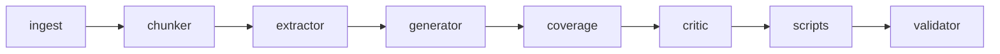
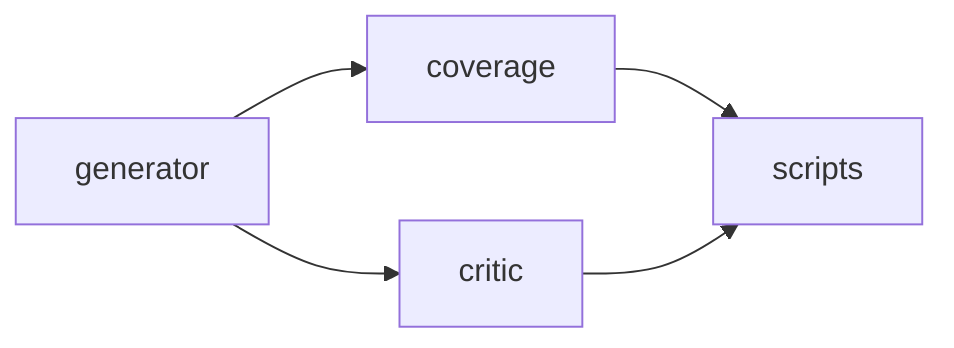
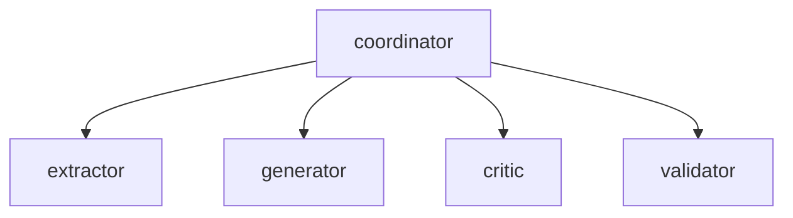

# Orchestration patterns and monitoring

The CLI selects one of three real orchestration implementations. All three
share the validated `Blackboard`; ADK and CrewAI remain optional adapters and
are not claimed in a report unless explicitly invoked.

## Sequential



Each dependency completes before the next worker starts. This is the default
and is useful when deterministic ordering is more important than latency.

```powershell
python -m prd_agents samples\sample_prd.md --pattern sequential --out output\sequential
```

## Parallel



Coverage and critique receive the same immutable case snapshot and run through
`asyncio.to_thread` with a configurable semaphore. Their results are merged
into the Blackboard only after both complete, so unrelated writes cannot be
lost.

```powershell
python -m prd_agents samples\sample_prd.md --pattern parallel --max-parallel-agents 2 --out output\parallel
```

## Hierarchical



The coordinator delegates actual existing workers, evaluates their coverage
and critique results, and requests revisions up to
`MAX_HIERARCHY_CYCLES`. It does not fabricate completion when validation fails.

```powershell
python -m prd_agents samples\sample_prd.md --pattern hierarchical --max-hierarchy-cycles 2 --out output\hierarchical
```

## Configuration and monitoring

The `ARCH` switch selects the state transport independently from the pipeline
topology. `blackboard` persists validated keys in ADK session state and keeps a
versioned provenance log. `message_passing` sends `StateUpdate` Pydantic
messages through an in-memory bus and keeps the same contract at the backend
boundary, making transport overhead and isolation comparable.

`--pattern` overrides `PIPELINE_PATTERN`; CLI numeric options override their
environment values, and defaults apply otherwise. Supported settings include:

```env
PIPELINE_PATTERN=sequential
MAX_PARALLEL_AGENTS=2
MAX_HIERARCHY_CYCLES=2
MONITORING_ENABLED=true
MONITORING_DIR=monitoring
EVENT_LOG_VERBOSITY=normal
```

Monitoring emits typed events for runs, agents, Blackboard reads/writes,
delegation, validation, revisions, and failures. Optional callback exceptions
are isolated from the pipeline. Each run produces `events.jsonl`,
`agent_metrics.json`, CSV metrics, heat-map PNGs, a timeline PNG, and
`summary.json`. Metrics show unavailable token/cost data as unavailable.
The ADK adapter also uses lifecycle callbacks at agent, model, and MCP tool
boundaries, recording intermediate state keys and typed output summaries.

## Comparing architectures

Run a deterministic smoke comparison (one run per pattern):

```powershell
python -m prd_agents samples\sample_prd.md --compare-architectures --runs 1 --out output\comparison
```

Use `--runs 40` only when 40 actual runs are desired. The comparison writes
JSON and CSV records with run IDs, pattern, wall-clock duration, status, and
quality/coverage values. It does not claim that one pattern is better without
measured results.

## Framework boundaries and limitations

The custom orchestrators are the primary runtime because they can share the
existing Blackboard and expose deterministic dependency and concurrency
behavior. `build_adk_agents` still constructs native ADK topologies for
integrations, while the CrewAI/A2A service remains a separate remote service.
Neither is described as having executed a normal CLI run unless that adapter
is called. Browser execution, provider token usage, and cost are unavailable
unless separately measured.
