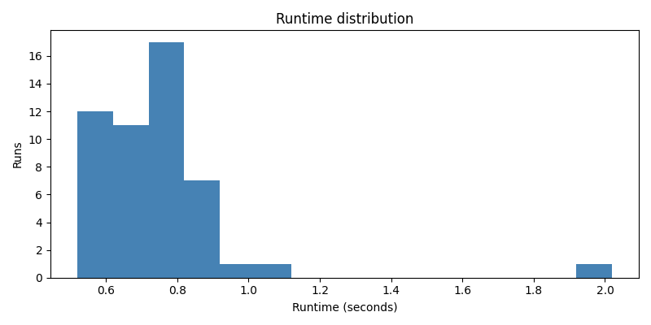
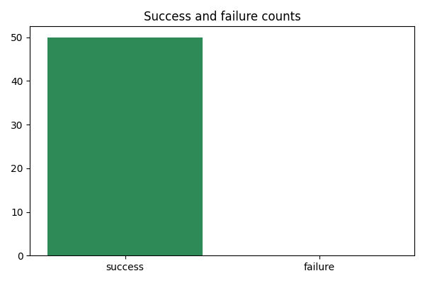
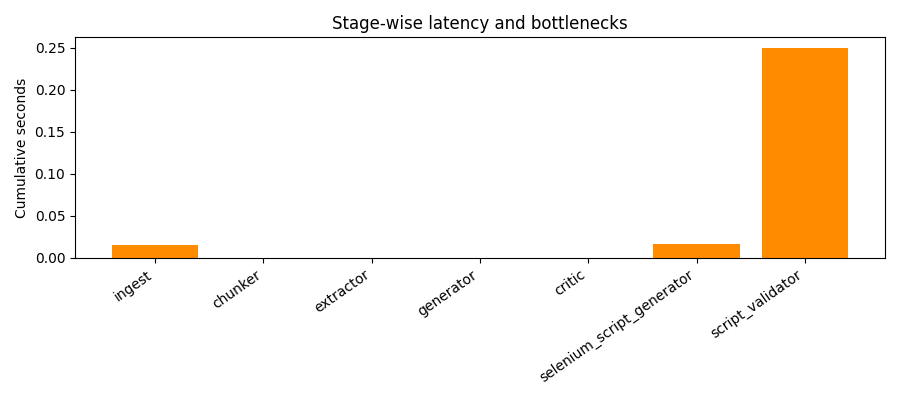
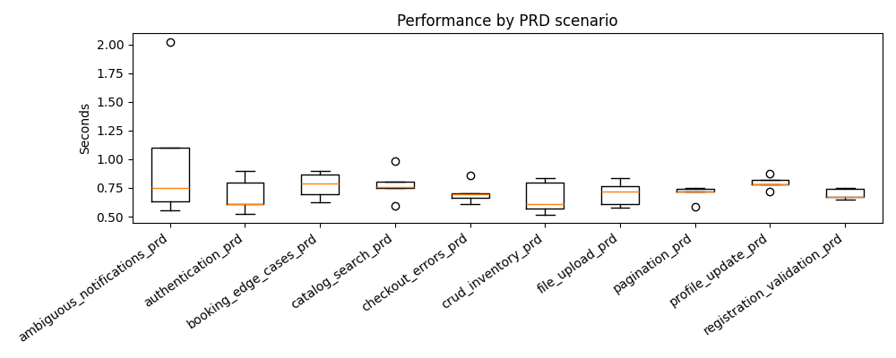
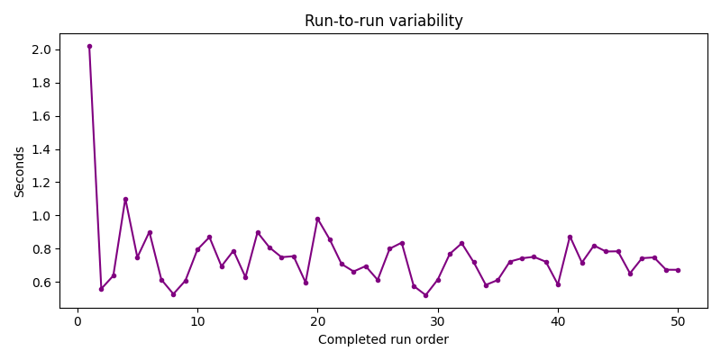
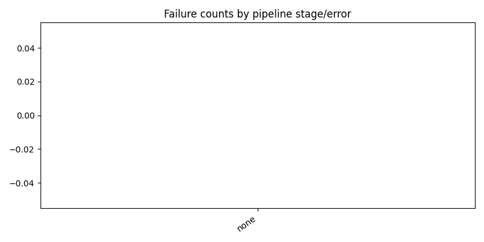

# Sequential Agentic AI Evaluation Report

This report contains only sequential, deterministic pipeline executions.
Browser results are marked unavailable unless explicitly requested and executed.

## Summary

- Runs: 50
- Success rate: 1.0
- Mean latency: 0.7523922419873997 seconds
- Median latency: 0.731542200082913 seconds
- P95 latency: 0.9444828199571927 seconds
- Throughput: 1.3290939807653506 runs/second
- Estimated cost per PRD: 0.0 USD
- Projected cost for 100 PRDs: 0.0 USD
- Projected cost for 1,000 PRDs: 0.0 USD

## Key findings

- Measured sequential success rate: 1.0.
- Measured p95 runtime: 0.9444828199571927 seconds.
- Deterministic runs produced no provider token usage; cost is estimated from configured pricing and is zero with the default prices.
- Browser execution was not requested; no browser test was counted as passed.

## Stage latency totals

- `script_validator`: 0.250000 seconds
- `selenium_script_generator`: 0.016000 seconds
- `ingest`: 0.015000 seconds
- `chunker`: 0.000000 seconds
- `extractor`: 0.000000 seconds
- `generator`: 0.000000 seconds
- `critic`: 0.000000 seconds

## Recommendations

- Repeat with `--browser` in an environment with Chrome and ChromeDriver to measure actual browser pass rates.
- Run LLM mode with explicit input/output prices to replace zero deterministic cost estimates with configured estimates.
- Investigate the highest cumulative stage latency before scaling to larger PRD volumes.

## Graphs

## Limitations

- Deterministic mode does not produce provider token usage; token and cost values are estimates.
- Browser execution is not counted unless explicitly requested and a browser/driver is available.
- No skipped or unexecuted browser test is counted as a pass.
